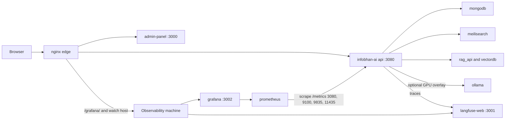

# Infobhan AI — deployment guide

How to run the Infobhan LibreChat stack for **local testing** and **production**, on a **single machine** or **separate app and observability machines**, over **TLS** or **IP (HTTP)**.

Related: [nginx/README.md](nginx/README.md) (edge modes and certificates), [`.env.example`](.env.example), [`.env.observability.example`](.env.observability.example).

---

## Architecture



Two Compose projects, kept separate on purpose:

| Project | Files | Services |
|---|---|---|
| **App** | [`docker-compose.yml`](docker-compose.yml), optional [`docker-compose.infobhan.yml`](docker-compose.infobhan.yml) | api (`infobhan-ai`), admin-panel, mongodb, meilisearch, vectordb, rag_api, nginx-local or nginx-tls; GPU overlay adds ollama, node_exporter, nvidia_gpu_exporter, ollama-exporter |
| **Observability** | [`docker-compose.observability.yml`](docker-compose.observability.yml) | langfuse-web, langfuse-worker, ClickHouse, MinIO, Redis, Postgres, Prometheus, Grafana |

Start the app with [`scripts/compose-app.ps1`](scripts/compose-app.ps1) (Windows) or [`scripts/compose-app.sh`](scripts/compose-app.sh) (Linux/macOS). Start observability with `--env-file .env.observability` and do **not** run plain `docker compose up` on the observability host (that would start LibreChat).

[`docker-compose.langfuse-fanout.yml`](docker-compose.langfuse-fanout.yml) is an optional central/tenant Langfuse export path. It is **not** required for local or standard production and is omitted from the runbooks below. See [otel/langfuse-fanout/README.md](otel/langfuse-fanout/README.md) if you need it.

---

## Prerequisites and sizing

- Docker Engine with Compose v2.
- Free host ports for the mode you choose (see [Ports and URLs](#ports-and-urls-reference)).
- On Linux, set `UID` and `GID` in `.env` (or the shell) to match the user that owns `./data-node` and `./meili_data_v1.35.1`. On Windows/macOS Docker Desktop these are often unset; Compose warns and defaults to blank.
- Create an empty `debug-2a1742.log` in the repo root before the first `up`. The api service bind-mounts it.
- NVIDIA Container Toolkit is required only when you merge the GPU overlay (Ollama and `nvidia_gpu_exporter`).
- **RAM (approximate, idle):**
  - App stack without Ollama: about 3–8 GB. Leave Docker Desktop at 8–12 GB on a 20 GB laptop so the host still has headroom.
  - Observability (especially ClickHouse + Langfuse): heavy. Prefer a separate machine in production. On one box, expect tens of GB when both stacks are busy.
  - Ollama with large models (for example `mistral-small:24b`) needs a GPU and can exhaust a 16–20 GB machine if loaded into system RAM.

---

## Configuration files

| File | Where | Role |
|---|---|---|
| `.env` | App machine | LibreChat, admin panel, Meilisearch, Langfuse client keys, `METRICS_SECRET`, `DOMAIN_*`, `OBS_PRIVATE_HOST` |
| `librechat.yaml` | App machine (mounted into api) | Endpoints, balance, registration, Infobhan (Local) Ollama URL |
| `.env.observability` | Observability machine | Langfuse stack secrets, init user, Grafana, Prometheus scrape targets |

Copy from the examples:

```bash
cp .env.example .env
cp .env.observability.example .env.observability
```

### Values that must match across machines

| App `.env` | Observability `.env.observability` |
|---|---|
| `LANGFUSE_PUBLIC_KEY` | `LANGFUSE_PUBLIC_KEY` (and used as init project public key) |
| `LANGFUSE_SECRET_KEY` | `LANGFUSE_SECRET_KEY` |
| `METRICS_SECRET` | `METRICS_SECRET` (Prometheus Bearer token for `/metrics`) |

`LANGFUSE_BASE_URL` on the **app** machine must be the **private** Langfuse HTTP URL (`http://<obs-host>:3001`), never the public watch hostname. Traces must not hairpin through public nginx.

### Secret generation

```bash
# 32-byte hex (64 characters) — suitable for most secrets below
openssl rand -hex 32

# CREDS_KEY: 32-byte AES key as 64-char hex
openssl rand -hex 32

# CREDS_IV: 16-byte IV as 32-char hex
openssl rand -hex 16
```

Set before production (and preferably before first local start):

| Variable | File | Notes |
|---|---|---|
| `ADMIN_PANEL_SESSION_SECRET` | `.env` | Min 32 characters; required for admin-panel to start |
| `JWT_SECRET`, `JWT_REFRESH_SECRET` | `.env` | Required for auth |
| `CREDS_KEY`, `CREDS_IV` | `.env` | 64-char and 32-char hex; leave blank only for disposable local `.env.temp` |
| `MEILI_MASTER_KEY` | `.env` | Meilisearch |
| `METRICS_SECRET` | both | Bearer for `GET /metrics` |
| `LANGFUSE_PUBLIC_KEY`, `LANGFUSE_SECRET_KEY` | both | Project API keys |
| `LANGFUSE_STACK_*` | `.env.observability` | Postgres, ClickHouse, MinIO, Redis, NEXTAUTH, salt, encryption key |
| `LANGFUSE_INIT_USER_PASSWORD` | `.env.observability` | First Langfuse UI user |
| `GRAFANA_ADMIN_PASSWORD` | `.env.observability` | Required; Grafana will not start with an empty password |

---

## Profile selection

[`scripts/compose-app.ps1`](scripts/compose-app.ps1) / [`scripts/compose-app.sh`](scripts/compose-app.sh) read `DOMAIN_CLIENT` from `.env`:

| `DOMAIN_CLIENT` | Profile | Compose files | Host ports |
|---|---|---|---|
| `https://…` and host is not `localhost` / `127.0.0.1` | `edge-tls` | `docker-compose.yml` **+** `docker-compose.infobhan.yml` | 80, 443 |
| Anything else (e.g. `http://localhost:3000`) | `edge-local` | `docker-compose.yml` only | 3000 → nginx 80 |

Merge the GPU overlay on `edge-local` when you need Ollama:

```powershell
.\scripts\compose-app.ps1 -WithGpu up -d
```

```bash
./scripts/compose-app.sh --with-gpu up -d
```

`edge-tls` always merges the Infobhan GPU overlay.

---

## Local testing (single machine, no GPU)

### 1. App `.env`

```env
DOMAIN_CLIENT=http://localhost:3000
DOMAIN_SERVER=http://localhost:3000
ADMIN_PANEL_URL=http://admin.localhost:3000
ADMIN_PANEL_SESSION_SECRET=<openssl rand -hex 32>
# Optional if observability runs on the same PC:
OBS_PRIVATE_HOST=host.docker.internal
LANGFUSE_BASE_URL=http://host.docker.internal:3001
LANGFUSE_PUBLIC_KEY=pk-lf-change-me
LANGFUSE_SECRET_KEY=sk-lf-change-me
METRICS_SECRET=change-me-metrics-secret
```

Also set `JWT_SECRET`, `JWT_REFRESH_SECRET`, `MEILI_MASTER_KEY`, and preferably `CREDS_KEY` / `CREDS_IV`.

### 2. Hosts file (admin + watch names)

Windows (elevated) or Linux `/etc/hosts`:

```text
127.0.0.1 admin.localhost watch.localhost
```

Without this, `http://admin.localhost:3000` and `http://watch.localhost:3000` will not resolve. Chat at `http://localhost:3000` still works (default nginx server).

### 3. Start the app

```powershell
# Ensure bind-mount file exists
if (-not (Test-Path debug-2a1742.log)) { New-Item -ItemType File debug-2a1742.log | Out-Null }
.\scripts\compose-app.ps1 up -d
```

```bash
touch debug-2a1742.log
./scripts/compose-app.sh up -d
```

Expected containers: `infobhan-ai`, `admin-panel`, `chat-mongodb`, `chat-meilisearch`, `vectordb`, `rag_api`, `librechat-nginx-local-1`. **No** `ollama`.

### 4. Optional: observability on the same PC

```bash
# .env.observability (selected lines)
LANGFUSE_STACK_NEXTAUTH_URL=http://watch.localhost:3000
GF_SERVER_ROOT_URL=http://watch.localhost:3000/grafana/
LANGFUSE_PUBLIC_KEY=pk-lf-change-me
LANGFUSE_SECRET_KEY=sk-lf-change-me
METRICS_SECRET=change-me-metrics-secret
METRICS_SCRAPE_TARGET=host.docker.internal:3080
# Exporters are down until you start with -WithGpu / --with-gpu:
NODE_EXPORTER_SCRAPE_TARGET=host.docker.internal:9100
NVIDIA_GPU_SCRAPE_TARGET=host.docker.internal:9835
OLLAMA_EXPORTER_SCRAPE_TARGET=host.docker.internal:11435
GRAFANA_ADMIN_PASSWORD=change-me-grafana-admin
LANGFUSE_INIT_USER_EMAIL=admin@example.com
LANGFUSE_INIT_USER_PASSWORD=change-me-langfuse-user

docker compose --env-file .env.observability -f docker-compose.observability.yml up -d
```

### 5. Verify

| Check | Expect |
|---|---|
| `http://localhost:3000` | Infobhan AI chat UI |
| `http://admin.localhost:3000` | Admin panel login |
| `http://watch.localhost:3000` | Langfuse (if obs running) |
| `http://watch.localhost:3000/grafana/` | Grafana (if obs running) |
| `docker ps` | No ollama container |

`Infobhan (Local)` models in `librechat.yaml` call `http://ollama:11434` and will fail until the GPU overlay is running. Use OpenRouter or other configured cloud endpoints for local chat tests.

---

## Production — single machine

Replace `<SERVER_IP>` with the host’s address. Prefer TLS when the host has public DNS.

### TLS path

**Unverified here:** certificate issuance and a live TLS start were not run in this documentation pass.

1. **DNS** A/AAAA records: `infobhan.ai`, `admin.infobhan.ai`, `watch.infobhan.ai` → this host.
2. **Certificates** (after nginx can serve ACME on port 80, or issue offline and copy):

```bash
certbot certonly --webroot -w ./nginx/certbot/www \
  -d infobhan.ai -d admin.infobhan.ai -d watch.infobhan.ai
# copy/symlink live certs into:
#   nginx/certs/fullchain.pem
#   nginx/certs/privkey.pem
```

3. **App `.env`:**

```env
DOMAIN_CLIENT=https://infobhan.ai
DOMAIN_SERVER=https://infobhan.ai
ADMIN_PANEL_URL=https://admin.infobhan.ai
ADMIN_PANEL_SESSION_COOKIE_SECURE=true
OBS_PRIVATE_HOST=host.docker.internal
LANGFUSE_BASE_URL=http://host.docker.internal:3001
# LANGFUSE_* keys, METRICS_SECRET, JWT_*, CREDS_*, MEILI_MASTER_KEY, ADMIN_PANEL_SESSION_SECRET
```

4. **`.env.observability`:**

```env
LANGFUSE_STACK_NEXTAUTH_URL=https://watch.infobhan.ai
GF_SERVER_ROOT_URL=https://watch.infobhan.ai/grafana/
METRICS_SCRAPE_TARGET=host.docker.internal:3080
NODE_EXPORTER_SCRAPE_TARGET=host.docker.internal:9100
NVIDIA_GPU_SCRAPE_TARGET=host.docker.internal:9835
OLLAMA_EXPORTER_SCRAPE_TARGET=host.docker.internal:11435
# Matching LANGFUSE_* keys and METRICS_SECRET
```

5. **Start:**

```bash
# Observability first (or in parallel)
docker compose --env-file .env.observability -f docker-compose.observability.yml up -d

# App: DOMAIN_CLIENT selects edge-tls and merges GPU overlay
./scripts/compose-app.sh up -d
# Windows: .\scripts\compose-app.ps1 up -d
```

6. **URLs:** `https://infobhan.ai`, `https://admin.infobhan.ai`, `https://watch.infobhan.ai`, `https://watch.infobhan.ai/grafana/`.

### IP path (HTTP)

Use only on a **trusted network or VPN**. No HSTS; admin cookies are not Secure.

1. **App `.env`:**

```env
DOMAIN_CLIENT=http://<SERVER_IP>:3000
DOMAIN_SERVER=http://<SERVER_IP>:3000
ADMIN_PANEL_URL=http://admin.localhost:3000
ADMIN_PANEL_SESSION_COOKIE_SECURE=false
OBS_PRIVATE_HOST=host.docker.internal
LANGFUSE_BASE_URL=http://host.docker.internal:3001
```

`DOMAIN_CLIENT` with a non-https URL selects **`edge-local`** (host port **3000**).

2. **Start with GPU if needed:**

```powershell
.\scripts\compose-app.ps1 -WithGpu up -d
```

```bash
./scripts/compose-app.sh --with-gpu up -d
docker compose --env-file .env.observability -f docker-compose.observability.yml up -d
```

3. **What works by IP today (docs-only; no extra nginx path):**

| Surface | URL | Notes |
|---|---|---|
| Chat | `http://<SERVER_IP>:3000` | nginx `default_server` for localhost |
| Langfuse | `http://<SERVER_IP>:3001` | Direct publish from observability |
| Grafana | `http://<SERVER_IP>:3002/grafana/` | Keep the `/grafana/` path |
| Admin panel | **Not** by bare IP | No host port; nginx routes `admin.localhost` only |

4. **Admin workstations** need a hosts entry pointing at the server:

```text
<SERVER_IP> admin.localhost
```

Then open `http://admin.localhost:3000` with `ADMIN_PANEL_URL=http://admin.localhost:3000`. Optionally add `watch.localhost` if you prefer the nginx watch proxy over direct `:3001` / `:3002`.

---

## Production — separate machines

**Unverified here:** a two-host live deploy was not run in this documentation pass.

- **App machine:** nginx, api, admin-panel, mongodb, meilisearch, vectordb, rag_api, optional GPU services.
- **Observability machine:** Langfuse stack, Prometheus, Grafana.

### Shared secrets

Identical on both hosts: `LANGFUSE_PUBLIC_KEY`, `LANGFUSE_SECRET_KEY`, `METRICS_SECRET`.

### App machine `.env`

```env
OBS_PRIVATE_HOST=<OBS_PRIVATE_IP>
LANGFUSE_BASE_URL=http://<OBS_PRIVATE_IP>:3001
# Prefer private binds for scrapes (defaults are 0.0.0.0):
APP_METRICS_BIND=<APP_PRIVATE_IP>
NODE_EXPORTER_BIND=<APP_PRIVATE_IP>
NVIDIA_GPU_EXPORTER_BIND=<APP_PRIVATE_IP>
OLLAMA_EXPORTER_BIND=<APP_PRIVATE_IP>
```

### Observability machine `.env.observability`

```env
LANGFUSE_WEB_BIND=<OBS_PRIVATE_IP>
GRAFANA_BIND=<OBS_PRIVATE_IP>
METRICS_SCRAPE_TARGET=<APP_PRIVATE_IP>:3080
NODE_EXPORTER_SCRAPE_TARGET=<APP_PRIVATE_IP>:9100
NVIDIA_GPU_SCRAPE_TARGET=<APP_PRIVATE_IP>:9835
OLLAMA_EXPORTER_SCRAPE_TARGET=<APP_PRIVATE_IP>:11435
```

### Firewall matrix

| Direction | Port | Purpose |
|---|---|---|
| Public → app | **80, 443** (TLS) or **3000** (IP path) | Browser via nginx |
| Obs → app | **3080** | Prometheus scrape of LibreChat `/metrics` (Bearer `METRICS_SECRET`) |
| Obs → app | **9100** | node_exporter |
| Obs → app | **9835** | nvidia_gpu_exporter |
| Obs → app | **11435** | ollama-exporter |
| App → obs | **3001** | Langfuse (traces + nginx watch proxy) |
| App → obs | **3002** | Grafana (nginx `/grafana/`) |
| Public → obs | **none** | Prefer private bind; browsers use app nginx `watch.*` |

### TLS path (two hosts)

Same DNS and certificates on the **app** machine as single-machine TLS. Observability stays private:

```env
# App
DOMAIN_CLIENT=https://infobhan.ai
DOMAIN_SERVER=https://infobhan.ai
ADMIN_PANEL_URL=https://admin.infobhan.ai
ADMIN_PANEL_SESSION_COOKIE_SECURE=true
OBS_PRIVATE_HOST=<OBS_PRIVATE_IP>
LANGFUSE_BASE_URL=http://<OBS_PRIVATE_IP>:3001

# Obs
LANGFUSE_STACK_NEXTAUTH_URL=https://watch.infobhan.ai
GF_SERVER_ROOT_URL=https://watch.infobhan.ai/grafana/
```

Start observability on the obs host, then `./scripts/compose-app.sh up -d` on the app host (`edge-tls` + GPU overlay).

### IP path (two hosts)

```env
# App
DOMAIN_CLIENT=http://<APP_PUBLIC_OR_VPN_IP>:3000
DOMAIN_SERVER=http://<APP_PUBLIC_OR_VPN_IP>:3000
ADMIN_PANEL_URL=http://admin.localhost:3000
OBS_PRIVATE_HOST=<OBS_PRIVATE_IP>
LANGFUSE_BASE_URL=http://<OBS_PRIVATE_IP>:3001
```

```bash
./scripts/compose-app.sh --with-gpu up -d
```

Chat: `http://<APP_IP>:3000`. Langfuse/Grafana: either through hosts-file `watch.localhost` via app nginx, or directly `http://<OBS_PRIVATE_IP>:3001` and `http://<OBS_PRIVATE_IP>:3002/grafana/` from the private network. Admin still needs `<APP_IP> admin.localhost` on admin workstations.

---

## Default access and credentials

There are **no hard-coded default passwords** in the images. Credentials come from env vars or first-run behaviour.

| Surface | How you get access | Default / example value |
|---|---|---|
| **infobhan-ai (chat)** | Self-register (`ALLOW_REGISTRATION=true`) or `npm run create-user` | **No seeded user.** First registered account becomes **ADMIN**; later accounts are **USER**. New users get `balance.startBalance` **2_000_000** credits ($2) from `librechat.yaml`. |
| **admin-panel** | Same LibreChat **ADMIN** account (`ACCESS_ADMIN`) via `POST /api/admin/login/local` | **No separate password.** `ADMIN_PANEL_SESSION_SECRET` is a session encryption key, not a login. |
| **Langfuse** | Init user from `.env.observability` on **empty** Postgres | Example: email `admin@example.com`, password `change-me-langfuse-user` (`LANGFUSE_INIT_USER_*`). Change before first start. |
| **Grafana** | Static admin from env | User `GRAFANA_ADMIN_USER` (default **`admin`**), password `GRAFANA_ADMIN_PASSWORD` (example `change-me-grafana-admin`). Sign-up disabled. **Not** synced with LibreChat admins. |

### Bootstrap steps

1. Open chat → **Register** with your email and password (first user = admin).
2. Open admin panel → sign in with that same account.
3. Open Langfuse → sign in with `LANGFUSE_INIT_USER_EMAIL` / `LANGFUSE_INIT_USER_PASSWORD`.
4. Open Grafana → sign in with `GRAFANA_ADMIN_USER` / `GRAFANA_ADMIN_PASSWORD`.

`LANGFUSE_INIT_*` applies only when the Langfuse Postgres volume is empty. Changing the password later requires the Langfuse UI or deleting the volume (data loss).

### Internal service secrets (not end-user logins)

| Secret | Where set | Used by |
|---|---|---|
| `METRICS_SECRET` | `.env` + `.env.observability` | Prometheus → LibreChat `/metrics` |
| `MEILI_MASTER_KEY` | `.env` | Meilisearch |
| `LANGFUSE_STACK_POSTGRES_*` | `.env.observability` | Langfuse Postgres |
| `LANGFUSE_STACK_CLICKHOUSE_*` | `.env.observability` | ClickHouse |
| `LANGFUSE_STACK_MINIO_*` | `.env.observability` | MinIO |
| `LANGFUSE_STACK_REDIS_AUTH` | `.env.observability` | Redis |
| `LANGFUSE_STACK_NEXTAUTH_SECRET`, `SALT`, `ENCRYPTION_KEY` | `.env.observability` | Langfuse app crypto / auth |
| `LANGFUSE_PUBLIC_KEY` / `LANGFUSE_SECRET_KEY` | both | LibreChat → Langfuse API (traces) |

---

## Ports and URLs reference

### Local (`edge-local`, DOMAIN_CLIENT=`http://localhost:3000`)

| Service | Host port | Browser URL |
|---|---|---|
| nginx → chat | 3000 | http://localhost:3000 |
| nginx → admin | 3000 (name-based) | http://admin.localhost:3000 |
| nginx → Langfuse | 3000 (name-based) | http://watch.localhost:3000 |
| nginx → Grafana | 3000 (name-based) | http://watch.localhost:3000/grafana/ |
| api (direct / metrics) | 3080 | http://localhost:3080 (dev only; browsers should use nginx) |
| Langfuse (direct) | 3001 | http://localhost:3001 |
| Grafana (direct) | 3002 | http://localhost:3002/grafana/ |

### Production TLS (`edge-tls`)

| Service | Host port | Browser URL |
|---|---|---|
| nginx HTTP → HTTPS | 80 → 443 | https://infobhan.ai |
| Admin | 443 | https://admin.infobhan.ai |
| Langfuse via nginx | 443 | https://watch.infobhan.ai |
| Grafana via nginx | 443 | https://watch.infobhan.ai/grafana/ |
| Private metrics / exporters | 3080, 9100, 9835, 11435 | Scraped by Prometheus only |

### Production IP (`edge-local` + optional `-WithGpu`)

| Service | Host port | Browser URL |
|---|---|---|
| Chat | 3000 | http://\<SERVER_IP\>:3000 |
| Admin | — | http://admin.localhost:3000 (hosts → SERVER_IP) |
| Langfuse direct | 3001 | http://\<SERVER_IP_OR_OBS\>:3001 |
| Grafana direct | 3002 | http://\<SERVER_IP_OR_OBS\>:3002/grafana/ |

---

## Operations

### Start / stop

```powershell
# App
.\scripts\compose-app.ps1 up -d
.\scripts\compose-app.ps1 down

# Observability (any host)
docker compose --env-file .env.observability -f docker-compose.observability.yml up -d
docker compose --env-file .env.observability -f docker-compose.observability.yml down
```

```bash
./scripts/compose-app.sh up -d
./scripts/compose-app.sh down
docker compose --env-file .env.observability -f docker-compose.observability.yml up -d
docker compose --env-file .env.observability -f docker-compose.observability.yml down
```

### Update images

```bash
./scripts/compose-app.sh pull
./scripts/compose-app.sh up -d
docker compose --env-file .env.observability -f docker-compose.observability.yml pull
docker compose --env-file .env.observability -f docker-compose.observability.yml up -d
```

### Logs

```bash
./scripts/compose-app.sh logs -f api
./scripts/compose-app.sh logs -f nginx-local   # or nginx-tls
docker compose --env-file .env.observability -f docker-compose.observability.yml logs -f grafana langfuse-web
```

### Backups

App host bind mounts / volumes:

- `./data-node` — MongoDB
- `./meili_data_v1.35.1` — Meilisearch
- `./uploads`, `./images`, `./logs`, `./skill`
- Docker volumes `pgdata2` (vectordb), `librechat-data`

Observability project volumes (`librechat-observability`): `langfuse_postgres_data`, `langfuse_clickhouse_data`, `langfuse_clickhouse_logs`, `langfuse_minio_data`, `langfuse_redis_data`, `prometheus_data`, `grafana_data`.

Stop writers before consistent file copies, or use volume snapshots.

### User management scripts

Run inside the api container (Mongo must be up):

```bash
docker exec -it infobhan-ai npm run create-user -- user@example.com "Display Name" username
docker exec -it infobhan-ai npm run list-users
docker exec -it infobhan-ai npm run reset-password
docker exec -it infobhan-ai npm run invite-user
docker exec -it infobhan-ai npm run ban-user
```

---

## Troubleshooting

| Symptom | Likely cause | What to do |
|---|---|---|
| `rag_api` restarts; missing OpenAI credentials | No embeddings key | Set `OPENAI_API_KEY` and/or `EMBEDDINGS_PROVIDER` / `RAG_*` in `.env` |
| `watch.*` returns 502 | Observability down or wrong `OBS_PRIVATE_HOST` | Start observability; set `OBS_PRIVATE_HOST` to a reachable host |
| `admin.localhost` / `watch.localhost` does not resolve | Missing hosts entry | Add `127.0.0.1` or `<SERVER_IP>` for those names |
| Port 3000 already in use | Another process or old admin publish | Stop the other listener; admin has no host port in this compose |
| Ollama never healthy / api waits forever | GPU overlay without NVIDIA / model pull | Use laptop without `-WithGpu`, or fix GPU runtime; healthcheck waits for pulled models |
| Prometheus targets down | Wrong scrape IP/port or `METRICS_SECRET` mismatch | Align targets and secrets; check private binds |
| nginx-tls exits on start | Missing `nginx/certs/fullchain.pem` or `privkey.pem` | Place certs before `edge-tls` |
| Traces never appear | `LANGFUSE_BASE_URL` uses `langfuse-web` or public watch URL from app | Use `http://host.docker.internal:3001` or `http://<OBS_PRIVATE_IP>:3001` |
| Infobhan (Local) models fail | Ollama not in this compose project | Start with `-WithGpu` / `edge-tls`, or use cloud endpoints |

---

## Check before go-live

Findings from the current stack that break or weaken a first deploy if left unchanged:

1. **`LANGFUSE_BASE_URL`** must not be `http://langfuse-web:3000` from the app stack (that hostname exists only on the observability Compose network). Use `host.docker.internal:3001` (same machine) or the obs private IP.
2. **`JWT_SECRET`, `JWT_REFRESH_SECRET`, `CREDS_KEY`, `CREDS_IV`** must be set for production (empty values are unsafe / may rely on disposable temp credentials).
3. **`rag_api`** needs embeddings credentials or it will crash-loop; file/RAG features stay broken until fixed.
4. **Rotate secrets** if `.env` was ever shared or committed (Langfuse keys, stack passwords, session secrets).
5. **`Infobhan (Local)`** in `librechat.yaml` requires the Ollama service from `docker-compose.infobhan.yml`.
6. **Open registration** (`ALLOW_REGISTRATION=true`) with no `registration.allowedDomains` lets anyone create an account and receive the starting balance. Restrict before exposing the host publicly.

---

## Hardening checklist

- [ ] Replace every `change-me-*` and empty secret before production.
- [ ] Set `registration.allowedDomains` (and consider `ALLOW_UNVERIFIED_EMAIL_LOGIN=false` with working SMTP).
- [ ] Bind metrics/exporter ports to private IPs; do not publish `/metrics` on the public internet.
- [ ] Prefer TLS + `ADMIN_PANEL_SESSION_COOKIE_SECURE=true` for any non-VPN deployment.
- [ ] Keep `.env` and `.env.observability` out of git; use the `*.example` files as templates only.
- [ ] Restrict Grafana and Langfuse to private network or SSO; they do not share LibreChat admin accounts.
- [ ] Back up Mongo, Meilisearch, uploads, and observability volumes on a schedule.

---

## Quick command cheat sheet

| Goal | Command |
|---|---|
| Local app (no GPU) | `.\scripts\compose-app.ps1 up -d` / `./scripts/compose-app.sh up -d` |
| Local or IP app + Ollama | `.\scripts\compose-app.ps1 -WithGpu up -d` / `./scripts/compose-app.sh --with-gpu up -d` |
| TLS production app | Set `DOMAIN_CLIENT=https://infobhan.ai`, then compose-app `up -d` |
| Observability | `docker compose --env-file .env.observability -f docker-compose.observability.yml up -d` |
